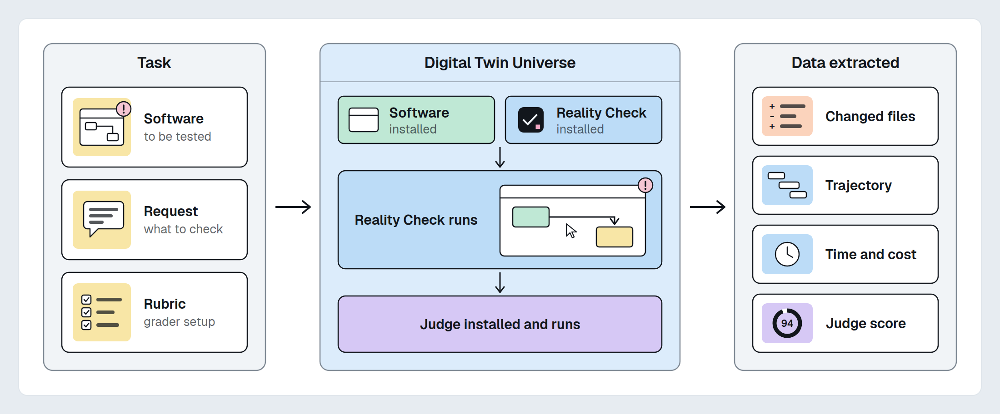
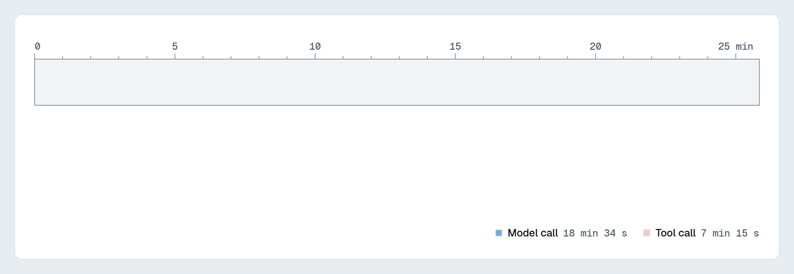
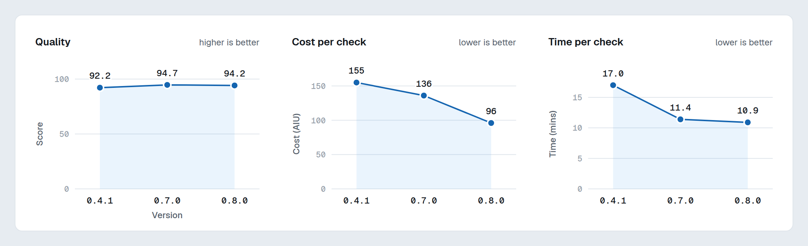

[Smart Tools](https://github.com/microsoft/amplifier-smart-tools) is a format for packaging domain expertise into tools that any agent can use. Think of them as standalone sub-agents. They have an agent harness built in, but they are used like an ordinary library or CLI. They expose higher-level command(s) that invoke agents under the hood, which we often refer to as "smart capabilities". A caller states what it wants rather than loading a domain's worth of context and doing the work itself. When done well, this approach has many benefits:
- It keeps the caller's context from getting filled with tasks that could be offloaded.
- Similarly, a smart tool includes the tools needed for the role it plays, without filling the main agent with additional MCPs, Skills, etc.
- The tool can be used from any host. For example, if you typically use GitHub Copilot for your work, a smart tool lets you delegate to another harness like Amplifier to get its benefits for that use case.
- Since a smart tool comes with its own harness, it means it will behave the same anywhere. The capabilities can be evaluated once, in isolation. This is the focus of this blog.
- The caller can use any of the recommended models and harnesses the tool has implemented and validated. This gives another lever to pull to trade off cost, time, and quality.

One of the smart tools we have been working on is [Reality Check](https://github.com/Microsoft/amplifier-smart-tool-reality-check). Its entire focus is to be the most capable tester so that work you get back from your agent is validated to be working as expected. 

To make sure the tool was effective and to optimize it, we asked a few key questions:
- How well can it do the tasks it's meant for?
- Once we have a tool that meets our quality bar, can we further optimize it for cost, quality, and time?
- How do other agents interact with the tool and is it what we expected?

## Evaluation Tasks Running in Digital Twin Universes

Creating quality evaluation tasks, specific to what you want to measure, is always the hardest part. It's important to strike a balance between difficulty and realism/messiness that real users will put any agent through. Our eight tasks were created by having an agent brainstorm difficult evaluations from the user stories in Reality Check's vision doc, and then filtering them down to realistic ones built on open source apps like Excalidraw, GitHub Desktop, and microsoft/edit. Each task patches in a subtle defect that only shows up in a specific state (a slow network, non-ASCII text, a second click), then gives the agent a broad request like "Check that the commit/change management feature all works as expected". Every run happens in its own [Digital Twin Universe](https://github.com/microsoft/amplifier-smart-tool-digital-twin-universe) (DTU) and an agent judge grades what was done from 0 to 100 against a rubric which we created. The one exclusion is set up to validate if a capability is automatically installed - which is specific to the Reality Check tool case. The full harness and tasks are available [here](https://github.com/microsoft/amplifier-smart-tool-reality-check/tree/main/evaluations).

*Overview diagram of the evaluation setup for Reality Check*

Every run captures all the data needed to be able to determine how it's doing and optimize the tool later. Particularly important are the full trajectories of the Reality Check harness, the wall clock time, cost, and grader results. We additionally can easily capture everything the agent changed since we know the start state of the DTU.

### Analyzing Trajectories and Runs

We run the evaluations and use the extracted data to figure out how to improve the tool's smart capability by creating visualizations to be able to get a sense of how the system is behaving to help drive our intuition of what needs to be improved.

*A visualization of the trajectory of an evaluation task. This type of visualization made it clear the agent was wasting time on installing and testing tools that should already be set up for it*

For agents, this data is also a gold mine. They very efficiently synthesize across the evaluation trajectories and graders to suggest areas of improvement.
In the case of Reality Check, it became immediately obvious that whenever faced with a web task, the agent always ended up having to install a browser and a way to control it, taking up valuable time and LLM calls. Naturally, this led us to bundling agent-browser and having it pre-installed as a tool available to the agent inside of Reality Check. As an aside, the beauty of smart tools is that we can bundle tools (and skills) inside, and they never take up context within the calling agent. In another example, we noticed that the agent was doing checks by taking things step by step. We then instructed it to write scripts instead, and as an example, for one of the tasks individual tool calls went down from 51 to 11 - reducing cost and time.

### Results

We ran the suite of eight tasks at three points as we worked on improving Reality Check over a period of about two weeks as we improved the tool. Each run used the Copilot SDK with `gpt-6.1-sol`. In the second evaluation run corresponding to version 0.7.0 of the tool (treating the first as the baseline), we had added a headless browser and computer use tools, guidance for how to capture evidence from terminal UIs, and updated our DTUs to include the tools that are typically already shipped with systems that the base containers missed, amongst other changes. Alone those changes led to a 12% reduction in cost and a 33% reduction in wall clock time per check. Then, in the third evaluation run (version 0.8.0), we changed the reasoning effort from high to medium and made prompt updates to write more scripts for testing (as opposed to doing things one small step at a time - which we noticed from the trajectories), and instructed it to do checks in parallel. Combined, from the baseline we saw a 36% reduction in wall clock time per check and a 38% reduction in cost (measured in Copilot's AIU or AI Credits), all whilst not regressing on quality.

*Quality, cost, and time of Reality Check across three versions*

## Trigger Evals

Whilst we can optimize smart tools in isolation, most of the time Reality Check will be used like a sub-agent by another host. As such, it's important to also measure how it's being used by another host. Here we set up one experiment - checking if the tool gets triggered by a host agent (such as GitHub Copilot, although we validated others as well) when appropriate and how it reports back its findings to the caller. We set up what we refer to as "trigger" evaluations that measure if Reality Check is invoked when it should be, and vice versa. Each run used `gpt-6.1-sol`, one run per task. 

Across the three trigger tasks, the mean score went from 66.7 before our changes to 100 after them. Before, the agent used Reality Check when the user asked it to check the app, but not after it fixed a bug that would have benefited from a Reality Check. First, we rewrote the skill's description, which is what the agent sees when it decides whether to load a skill to learn about Reality Check. Before it said:

> Checks that an app works the way a real user would experience it, on your machine, in a Digital Twin Universe, or in one it sets up for you, and returns evidence for every finding. Use after an agent builds a feature or fix, when passing tests are not enough evidence that a user can do what they came to do. [...] Triggers on "reality-check".

After our changes:

> Checks that an app works the way a real user would experience it and returns evidence for every finding. [...] Use whenever a fix or capability needs to be validated: once you have fixed a bug, or built or changed a feature, run a check of what changed before you report the work as done, so the report says what a user can actually do, not only what the code or tests suggest. Also use when asked to check, verify, or make sure an app works, and when the user mentions "reality check" directly.

Second, `check-software --help`, which the skill tells the agent to read before it runs a check, got a new "After the check" section. In some runs, the agent ran a check but then told the user only what it changed. The section says:

> Tell the user what the check found, not only what you changed: the verdicts, each failure's step, action, and what was recorded, and the report's path.

## Conclusion

Smart Tools allow us to create experts that are optimized through evaluations. In Reality Check, that means that we can provide the optimal tools and instructions for validating all sorts of software, without burdening a main agent's context with all of it. Imagine if you now had a fleet of smart tools, each with its own role. Without keeping them in isolation, it would be more difficult to manage the context and tools, not to mention evaluating them in a capacity so that they are portable across the many surfaces where they might be used. Whilst they are standalone, that does not mean they have to be treated as such. We created "trigger" evaluations to measure the interaction between a smart tool and its caller in order to optimize that experience as well. There is a whole host of other avenues we could measure, such as which model performs the best or A/B testing various parts of the tool. If you found this compelling, be sure to check out Reality Check by asking your agent:

> Go to https://github.com/microsoft/amplifier-smart-tool-reality-check and install it.

Or, if you want to experience more of the smart tool ecosystem:

> Go to https://github.com/microsoft/amplifier-smart-tools and install it.
